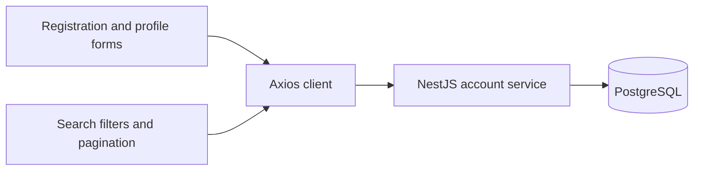

# UserConnect - Modern User Directory Frontend

A modern, responsive web application for user authentication and directory search built with React, TypeScript, and Tailwind CSS.

## Features

- **Authentication System**
  - User registration with form validation
  - Secure login with JWT token management
  - Persistent authentication state
  - Bearer token attached to API requests

- **Advanced User Search**
  - Search by name or email
  - Filter by location (city, country)
  - Age range filtering
  - Gender filtering
  - Sort by multiple criteria
  - Pagination support

- **Modern UI/UX**
  - Responsive design for all devices
  - Clean, professional interface
  - Loading states and error handling
  - Accessible form components

## Architecture and trade-offs

The [NestJS account service](https://github.com/rezanicgil/authentication-kafka) handles authentication, filtering and persistence.



Filters travel in the query string and the API returns a page of results. Session data persists across reloads in browser local storage, where scripts on the same origin can read it. Use synthetic accounts for the demo. The client has no refresh-token flow.

## Tech Stack

- **Frontend Framework**: React 19 with TypeScript
- **Build Tool**: Vite 7
- **Styling**: Tailwind CSS 4
- **Form Management**: React Hook Form with Yup validation
- **HTTP Client**: Axios
- **Icons**: Lucide React & Heroicons
- **Date Handling**: date-fns
- **UI Components**: Headless UI

## Getting Started

### Prerequisites

- Node.js 20.19+ on the 20.x line, or 22.12+
- npm or yarn

### Installation

1. Clone the repository:
```bash
git clone https://github.com/rezanicgil/authentication-fe.git
cd authentication-fe
```

2. Install dependencies:
```bash
npm ci
```

3. Set up environment variables:
```bash
cp .env.example .env
```

Edit `.env` and set your API base URL:
```
VITE_API_BASE_URL=http://localhost:3000
```

4. Start the development server:
```bash
npm run dev
```

The application will be available at `http://localhost:5173`

## API Integration

This frontend integrates with the following API endpoints:

### Authentication
- `POST /auth/register` - User registration
- `POST /auth/login` - User login

### User Search
- `GET /users/search` - Advanced user search with filters

### User Management
- `PUT /users/profile` - Update user profile information

### Required API Response Format

**Authentication Response:**
```json
{
  "token": "jwt-token",
  "user": {
    "id": "uuid",
    "email": "user@example.com",
    "firstName": "John",
    "lastName": "Doe",
    // ... other user fields
  }
}
```

**Search Response:**
```json
{
  "users": [/* array of user objects */],
  "pagination": {
    "page": 1,
    "limit": 10,
    "total": 25,
    "totalPages": 3,
    "hasNext": true,
    "hasPrev": false
  }
}
```

**User Update Response:**
```json
{
  "user": {
    "id": "uuid",
    "email": "user@example.com",
    "firstName": "John",
    "lastName": "Doe",
    // ... other updated user fields
  },
  "message": "Profile updated successfully"
}
```

## Project Structure

```
src/
├── components/
│   ├── auth/           # Authentication components (LoginForm, RegisterForm)
│   ├── layout/         # Layout components (AuthLayout, Navbar)
│   ├── profile/        # Profile components (ProfileForm)
│   ├── search/         # User search components (SearchFilters, UserCard, UserSearch)
│   └── ui/            # Reusable UI components (Button, Input, Select)
├── context/           # React context providers (AuthProvider, authContext)
├── hooks/            # Custom React hooks (useAuth)
├── services/          # API service functions (api.ts)
├── types/            # TypeScript type definitions (index.ts)
└── App.tsx           # Main application component
```

## Available Scripts

- `npm run dev` - Start development server
- `npm run build` - Build for production (includes TypeScript compilation)
- `npm run preview` - Preview production build
- `npm run lint` - Run ESLint

## Features Overview

### Authentication
- Secure user registration and login
- Client-side form validation
- JWT token management
- Persistent login state

### User Directory
- Advanced search with multiple filters
- Real-time search results
- Responsive user cards
- Pagination for large result sets

### Profile Management
- User profile viewing and editing
- Profile form with validation
- Personal information management

### Responsive Design
- Mobile-first approach
- Responsive grid layouts
- Touch-friendly interface
- Cross-browser compatibility

## Contributing

There is no frontend test runner. Run `npm run lint` and `npm run build` for static checks. To check the integration locally, register a synthetic user, update the profile and search for the updated account with the backend running.

1. Fork the repository
2. Create a feature branch
3. Make your changes
4. Add tests if applicable
5. Submit a pull request

## License

This project is licensed under the MIT License.
